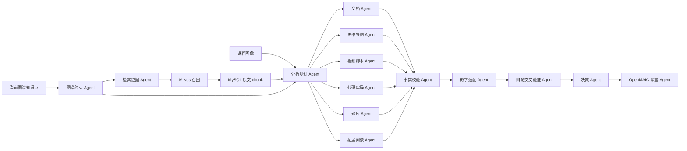
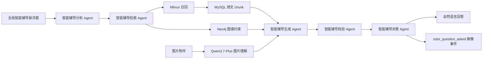

# 多智能体协作机制设计

## 设计目标

项目的多智能体系统不是简单把多个提示词串起来，而是围绕课程级本地知识库和知识图谱，实现“分析-检索-生成-校验-辩论-决策”的协同闭环。目标是降低大模型幻觉，保证学习资源可追溯、可解释、可根据学生画像动态调整。

所有 Agent 都必须工作在当前 `user_id + course_id` 上下文内。C 语言课程和 Python 课程的画像、知识库、图谱、路径、课堂和评估数据不能混用。

## Agent 列表

| Agent | 职责 | 输出 |
| --- | --- | --- |
| 课程画像 Agent | 通过多轮对话抽取当前课程专属画像，并在学习过程中随学随新 | student_profile |
| MinerU 解析 Agent | 调用 MinerU 精准解析 PDF/PPT/PPTX，下载结构化结果 | 页码/幻灯片级文本 |
| 本地解析/OCR 兜底 Agent | 在显式允许 fallback 时解析 PDF/PPT/PPTX，必要时使用 PaddleOCR | 带来源定位的文本 |
| 知识切分 Agent | 按章节、页码、标题和语义长度切分课程材料 | knowledge_chunks |
| 向量索引 Agent | 使用本地 BGE-M3 生成 chunk 向量并写入 Milvus | 课程级向量索引 |
| 知识图谱抽取 Agent | 从 MySQL chunk 中抽取课程知识点、层级、难度、来源和关系 | graph nodes / edges |
| Neo4j 写入 Agent | 按 `user_id + course_id` 替换并查询课程子图 | Neo4j 子图 |
| 图谱约束 Agent | 读取当前节点、父章节、前置、后续和相关节点 | graph_constraints |
| 检索证据 Agent | 组织 Agentic RAG 查询，Milvus 召回候选，MySQL 回表取原文 | knowledge_context / retrieval_trace |
| 分析规划 Agent | 汇总画像、知识点、证据和图谱约束，生成统一资源蓝图 | analysis_plan / ResourceBlueprint |
| 文档 Agent | 生成个性化讲解文档 | document |
| 思维导图 Agent | 生成树状思维导图结构 | mind_map |
| 视频脚本 Agent | 生成微课脚本、分镜和讲解节奏 | video |
| 代码实操 Agent | 生成浏览器可运行代码实验或编程练习要求 | code_lab |
| 题库 Agent | 生成选择题、填空题、简答题、编程题等评估资源 | exercise |
| 拓展阅读 Agent | 生成延伸阅读、复习提示和迁移任务 | reading |
| 事实校验 Agent | 检查内容是否被 MySQL 原文证据支撑，并遵守图谱边界 | verification_report |
| 教学适配 Agent | 检查难度、表达、资源形态是否匹配学生画像 | pedagogy_report |
| 辩论交叉验证 Agent | 对事实校验和教学适配结论做冲突审查，暴露幻觉风险 | debate_report |
| 决策 Agent | 判断资源可返回、需补检索、需重生成或走兜底 | decision_report |
| OpenMAIC 课堂 Agent | 将闭环大纲和 MySQL 原文证据提交给 OpenMAIC | openmaic_classroom |
| 路径规划 Agent | 根据画像、图谱、掌握度和时间约束生成学习路径 | learning_path |
| 学习评估 Agent | 汇总课堂测试、编程题、行为数据和学习结果 | assessment_result |
| 掌握度更新 Agent | 更新图谱节点掌握状态和颜色 | mastery_record |
| 画像更新 Agent | 把学习动作和评估结果回写学生画像 | profile_update |
| 智能辅导分析 Agent | 识别页面上下文、当前课程、知识点、文字/图片/语音问题 | tutor_analysis |
| 智能辅导检索 Agent | 对辅导问题执行 Agentic RAG，过滤不相关证据 | tutor_evidence |
| 智能辅导生成 Agent | 基于课程证据、图片理解和图谱约束生成自然回答 | tutor_answer |
| 智能辅导校验 Agent | 检查回答是否有课程证据支撑，必要时降级提示 | tutor_verification |
| 错题归档 Agent | 从评估事件中提取未通过选择题和编程题，按图谱章节归档 | wrong_question_book |
| 错题重做 Agent | 将重做正确的错题转换为综合评估 payload，触发评分回写 | wrong_question_redo |

## 课程知识库工作流

```text
用户选择课程
 -> 课程画像 Agent 构建该课程画像
 -> 上传 PDF/PPT/PPTX 或确认内置知识库
 -> MinerU 解析 Agent / 本地解析兜底 Agent
 -> 知识切分 Agent 写入 MySQL chunk
 -> 向量索引 Agent 写入 Milvus
 -> 知识图谱抽取 Agent 抽取节点和关系
 -> Neo4j 写入 Agent 替换当前用户当前课程子图
```

该链路中，MySQL chunk 是最终证据源；Milvus 是召回层；Neo4j 是逻辑关系约束层。

## 学习资源闭环



输出字段：

- `analysis_plan`
- `graph_constraints`
- `retrieval_trace`
- `verification_report`
- `pedagogy_report`
- `debate_report`
- `decision_report`
- `agent_events`
- `openmaic_classroom`

决策值：

- `accepted`：资源可返回并提交 OpenMAIC。
- `retrieve_more`：证据不足，需要补检索。
- `revise`：资源有事实或教学适配问题，需要重生成。
- deterministic fallback：外部模型不可用时走确定性兜底。

## Agentic RAG 规则

资源生成前必须执行 Agentic RAG：

1. 读取当前知识点和课程画像。
2. 从 Neo4j 获取当前节点、父章节、前置知识、后续知识、相关知识和来源 chunk。
3. 基于图谱约束构造多个检索 query。
4. Milvus 召回候选 chunk id。
5. MySQL 回表获取 `knowledge_chunks.content`。
6. Milvus 不可用或召回为空时使用 MySQL fallback。
7. 把原文证据、图谱关系、画像约束交给资源 Agent 和 OpenMAIC。

禁止只根据 topic 生成教学资源。生成内容应能解释其依据来自哪些 chunk 和哪些图谱关系。

## OpenMAIC 协作

OpenMAIC 课堂 Agent 的职责是提交标准课堂，不负责直接拼装最终教学内容。后端先通过 Agentic RAG + 知识图谱生成课堂大纲，再提交 OpenMAIC。

要求：

- 提交任务时设置 `enableTTS=true`。
- 课堂语音使用 OpenMAIC 自身配置的阿里云百炼 Qwen TTS。
- 不在后端 payload 中虚构 OpenMAIC 不支持的 speaker 字段。
- VoxCPM2 只作为可选实验 fallback，不作为默认课堂 TTS。
- requirement 中根据知识点类型加入一个重点交互策略：`visualization3d`、`code`、`game` 或 `simulation`。
- 后端通过 `/api/resources/openmaic-jobs/{job_id}` 代理轮询 OpenMAIC 任务。

## 学习评估与动态调整

学习评估 Agent 应综合：

- OpenMAIC 课堂完成状态
- 随堂测试结果
- 编程题运行结果
- 学习耗时
- 重试次数
- 已通过和未通过的子知识点

评估完成后：

1. 掌握度更新 Agent 写入 `knowledge_node_masteries`。
2. 图谱节点颜色按掌握状态更新。
3. 画像更新 Agent 把薄弱点、能力变化、偏好和风险信号写回课程画像。
4. 路径规划 Agent 重新生成后续路径。

`掌握基础` 仍视为未通过，只有 `达标良好` 和 `精通` 才算通过。

若知识点整体未通过，但 A/B 子项通过、C 子项未通过，则后续路径应插入 C 对应的薄弱点专项任务：

```text
原任务 -> 薄弱点专项 -> 下一个主线任务
```

专项任务仍指向原图谱节点，使用原节点的 RAG 证据和图谱约束生成补救课堂与练习。

错题集是评估闭环的一部分。错题归档 Agent 从 `assessment_submitted` 事件中提取原题题干、选项、学生答案、`correct_answer_index`、编程题要求、期望输出和用户输出，按当前课程知识图谱章节归档。学生在错题集重做正确后，错题重做 Agent 构造 `assessment_type=wrong_question_redo` 的综合评估提交，继续触发学习评估 Agent、掌握度更新 Agent、画像更新 Agent 和路径规划 Agent。

## 智能辅导闭环

智能辅导不是简单搜索知识库并展示原文，而是面向学生的即时多模态答疑闭环。



规则：

- 所有请求必须携带并校验当前 `course_id`。
- 文字问题使用主 LLM；包含图片时使用 `TUTOR_VISION_MODEL`，默认 `qwen3.7-plus`。
- RAG 阶段先用 Milvus 召回，再从 MySQL 取原文证据；Neo4j 提供当前节点、父章节、前后继和相关节点。
- 检索结果必须做相关性过滤，避免把不相关 chunk 当证据。
- 回答应结合证据进行解释、举例、指出易错点或给出下一步练习，不应把 chunk 原文原样贴给学生。
- 面向普通学生的 UI 默认隐藏原始 RAG 证据、结构化卡片和图谱关系调试块，但 API 仍保留这些字段供调试和评审审计。
- 如果没有有效证据，回答应明确证据不足并提示补充课程资料或更具体的章节信息。

## 前端可视化要求

知识点学习页应展示：

- OpenMAIC 标准课堂主区域
- 该节课文档
- 树状思维导图
- 编程练习与在线运行
- 本地知识库证据
- 检索轨迹
- 图谱约束
- 校验得分
- 辩论摘要
- 最终决策
- Agent 事件流

这些信息用于让用户和评审看到多智能体闭环，而不是只看到一个大模型输出结果。

学习评估页应展示多维评估仪表盘，并提供错题集入口。错题集独立页面按章节/小节分组展示错题，允许选择题和编程题重做；重做正确后应让用户看到该知识点评分和掌握状态会被同步更新。

全局智能辅导悬浮窗应在所有登录后页面可见，支持文字、图片和语音输入。学生端回答只保留自然语言讲解和操作建议，避免展示“本地知识库证据”“知识图谱关系”等内部调试块。
