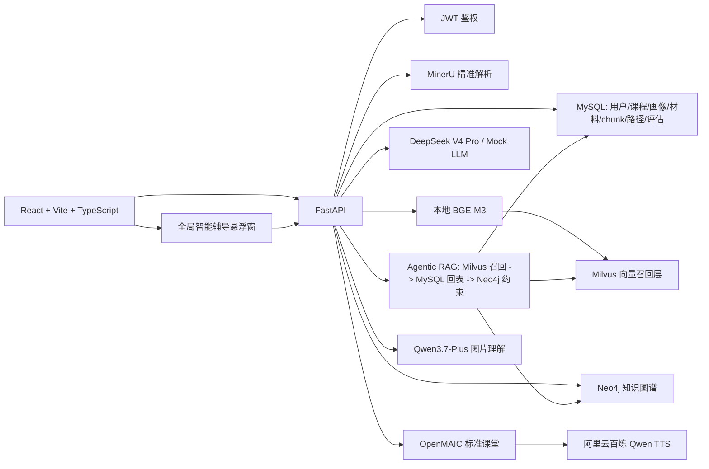

# 当前版本技术总览

## 项目定位

本项目是面向“基于大模型的个性化资源生成与学习多智能体系统开发”赛题的可运行原型。当前形态是多课程、课程级隔离的个性化学习平台：用户登录后先选择课程，再围绕该课程构建专属学生画像、课程本地知识库、知识图谱、动态学习路径、OpenMAIC 标准课堂、学习评估、错题重做和全局智能辅导闭环。

首期固定支持两门竞赛展示课程：

- `C语言程序设计`
- `Python程序设计`

两门课的数据必须相互独立。用户切换课程后，画像、材料、MySQL chunk、Milvus 向量集合、Neo4j 子图、学习路径、课堂缓存、评估记录和知识点掌握状态都以当前课程为准，不能串用其他课程的数据。

## 产品流程

```text
/auth 登录注册
 -> /courses 选择 C语言程序设计 或 Python程序设计
 -> /courses/:courseId/profile/interview 构建该课程专属学生画像
 -> /courses/:courseId/knowledge-base 上传材料或确认使用内置知识库
 -> /courses/:courseId/graph 构建并展示课程知识图谱
 -> /courses/:courseId/learning-path 生成动态学习路径
 -> /courses/:courseId/knowledge/:nodeId 进入知识点学习页
 -> OpenMAIC 标准课堂 + 文档/思维导图/代码练习/测验
 -> 学习评估
 -> /courses/:courseId/assessment/wrong-questions 错题重做
 -> 更新画像、掌握度、知识图谱节点颜色和后续学习路径
```

课程画像不再是全局画像。前端和后端都应通过 `course_id` 获取、创建和确认画像。没有该课程画像时，不能直接进入该课程的知识库、图谱、学习路径和学习页。

## 系统架构



## 课程数据隔离

所有核心业务数据都必须绑定当前登录用户和课程：

- 学生画像：`user_id + course_id`
- 画像访谈：`user_id + course_id`
- 课程材料：`course_id`，且课程归属 `user_id`
- 知识切片：`course_id + material_id`
- Milvus collection：按课程、embedding provider 和模型命名
- Neo4j 子图：节点和边都带 `user_id` 与 `course_id`
- 学习路径：`user_id + course_id`
- 课堂状态与缓存：`user_id + course_id + node_id`
- 学习评估和掌握度：`user_id + course_id + node_id`
- 错题集和重做记录：从当前课程 `assessment_submitted` 学习事件中归档，按当前课程图谱章节分组
- 智能辅导事件：`user_id + course_id + node_id/page_context`

内置课程也必须是用户确认后的每用户课程副本。用户没有点击确认使用内置课程时，不应自动把内置知识库挂到该用户账号下。

## 知识库构建链路

```text
PDF/PPT/PPTX 上传
 -> 保存文件与 CourseMaterial，返回 queued
 -> MaterialTaskQueue 后台解析
 -> MinerU 精准解析优先
 -> 本地解析/OCR 仅作为显式兜底
 -> 章节语义分块
 -> KnowledgeChunk 写入 MySQL
 -> BGE-M3 本地向量化
 -> Milvus course-scoped upsert
 -> DeepSeek V4 Pro 抽取知识结构
 -> Neo4j replace 当前用户当前课程子图
```

Milvus 只做向量召回，不做最终证据源。传给大模型和 OpenMAIC 的最终原文依据必须来自 MySQL `knowledge_chunks.content`。当 Milvus 不可用或召回为空时，后端应使用 MySQL fallback，保证学习资源生成仍能引用本地知识库原文。

## 知识图谱规范

知识图谱既要展示课程完整知识结构，也要服务学习路径和资源生成约束：

- 根节点应是课程名，例如 `C语言程序设计` 或 `Python程序设计`。
- 章节节点用于结构组织，不一定作为可学习任务。
- 如果二级节点下存在三级知识点，学习路径应规划三级知识点；只有没有子节点的二级节点才可作为学习任务。
- 节点颜色只表达掌握状态：灰色未学习、红色严重弱项、橙色掌握基础、浅绿色达标良好、绿色精通。
- `掌握基础` 仍视为未通过，只有 `达标良好` 和 `精通` 才算通过该知识点。

## Agentic RAG 与多智能体闭环

学习页资源生成必须走 Agentic RAG + 知识图谱约束，不允许只根据知识点标题裸生成。

闭环流程：

1. 分析规划：读取课程画像、目标知识点、图谱约束和历史掌握度。
2. 智能检索：基于当前节点、父章节、前置、后续、相关节点扩展检索查询。
3. 向量召回：Milvus 召回候选 chunk。
4. MySQL 回表：用 chunk id 获取最终原文证据。
5. 多模态生成：文档、思维导图、视频脚本、代码实验、练习题、拓展阅读分别由独立 Agent 负责。
6. 事实校验：检查生成内容是否被 MySQL 原文证据支撑。
7. 教学适配：检查难度、表达方式、资源形态是否匹配学生画像。
8. 辩论与交叉验证：对事实边界和教学策略做二次审查。
9. 决策：输出 `accepted`、`retrieve_more`、`revise` 或兜底路径。
10. OpenMAIC：基于通过闭环的大纲生成标准课堂。

后端资源响应应保留 `analysis_plan`、`graph_constraints`、`retrieval_trace`、`verification_report`、`pedagogy_report`、`debate_report`、`decision_report`、`agent_events` 和 `openmaic_classroom`，用于前端审计展示。

## OpenMAIC 与语音

OpenMAIC 是当前标准课堂的主学习表面。后端负责把 Agentic RAG + 知识图谱生成的大纲提交给 OpenMAIC `/api/generate-classroom`，前端通过后端代理 `GET /api/resources/openmaic-jobs/{job_id}` 轮询课堂状态，直到拿到 `/classroom/{id}`。

课堂语音默认使用 OpenMAIC 侧配置的阿里云百炼 Qwen TTS。VoxCPM2 只作为可选实验兜底，不作为默认方案。不要在后端课堂提交 payload 中虚构 OpenMAIC 不支持的发音人字段。

学习页会保存 `CourseLessonSession.lesson_state`。同一用户、同一课程、同一知识点再次进入时优先读取课堂和学习产物缓存；只有点击重新生成或传入强制刷新时才清理旧课堂缓存并重新提交 OpenMAIC。

## 智能辅导

登录后的应用壳层挂载全局智能辅导悬浮窗。学生可以在课程知识库、画像、图谱、路径、学习页和评估页随时提问。

后端接口为 `POST /api/tutor/chat`。服务流程是：

1. 校验当前用户拥有请求中的 `course_id`。
2. 识别页面上下文、当前知识点、文字问题、图片附件和对话历史。
3. 调用 `AgenticRAGService`：Milvus 召回候选，MySQL 回表取最终原文，Neo4j 提供图谱约束。
4. 对证据做相关性过滤，避免把不相关 chunk 直接拼给学生。
5. 文本问题使用配置的文本 LLM；带图片的问题使用 `TUTOR_VISION_MODEL`，默认 `qwen3.7-plus`。
6. 返回自然语言增强回答、agent 事件、检索轨迹、图谱约束和可选多模态卡片。
7. 课程画像存在时写入 `tutor_question_asked` 学习事件。

前端学生回答面默认只展示自然回答和必要建议，不展示原始 RAG 证据、结构化讲解卡和图谱关系卡，避免把调试信息暴露为普通学习内容。

## 学习评估与错题集

学习评估包含课堂状态、文档/思维导图/代码实验完成情况、题库选择题、编程运行结果、耗时和重试等维度。题库由当前知识点的题库 Agent 生成，选择题必须保存 `correct_answer_index`，编程题只给任务要求、起始代码和期望输出，不给完整答案。

评估提交写入当前课程的画像事件和掌握度记录。`掌握基础` 仍视为未通过，只有 `达标良好` 和 `精通` 才算通过。未通过后，学习路径服务会基于失败节点和弱项详情插入薄弱点专项任务。

错题集页面为 `/courses/:courseId/assessment/wrong-questions`。它从课程级 `assessment_submitted` 事件中归档未答对的选择题和未通过的编程题，并按知识图谱章节/小节分组。学生重做正确后，前端提交 `wrong_question_redo` 综合评估 payload，后端重新计算分数并继续更新画像、掌握度和路径。

## 动态画像与学习路径

学生画像是 durable product data，不是一次性 LLM 响应。平台中的学习动作都应产生画像更新信号：

- 课堂学习完成情况
- 文档和思维导图查看情况
- 随堂测试结果
- 编程题运行和通过情况
- 学习耗时、重试次数、薄弱点
- 自主超前学习行为

学习路径由课程画像、知识图谱、掌握度和时间约束共同生成。路径规划必须尊重画像中的可用时间，例如：

- `每天1小时`：一周 7 天可排，每周约 420 分钟。
- `一周1小时，周末才有空`：只排周六/周日，总时长不超过 60 分钟。

评估未通过时，后端应插入薄弱点专项补救任务，例如：

```text
1.1.1 -> 1.1.1 薄弱点专项 -> 1.1.2
```

专项任务仍绑定原知识图谱节点，用原节点的本地知识库证据和图谱约束生成补救资源。评估通过后，路径回到主线任务。

## 设计稿

当前有两份设计稿：

- `docs/design/product-page-mockups.html`：上一轮产品页面图。
- `docs/design/commercial-learning-site-design-options.html`：5 套商业级成熟学习网站候选视觉方案，仅作为 HTML 设计稿，不生成 PDF。

这些设计稿不直接代表已落地代码。后续前端样式重构应在不改变现有功能和数据流程的前提下，从候选方案中选择一种视觉方向落地。

## 验证命令

```powershell
conda activate a3
cd D:\softbei\a3
python -m pytest apps/api/tests -q

cd D:\softbei\a3\apps\web
npm run build
```

端到端验收应覆盖两门课程的独立流程：分别选择 `C语言程序设计` 和 `Python程序设计`，确认画像、知识库、图谱、学习路径、课堂缓存、评估记录和掌握度不会互相串用。

## 依赖核对结论

后端 `apps/api/requirements.txt` 与当前主线代码保持一致：

- Milvus 主链路使用 `pymilvus`，旧 Chroma 适配仅保留兼容代码，不作为默认依赖。
- 本地 BGE-M3 编码既使用 `sentence-transformers`，也有直接 `transformers + torch` 兜底路径，因此二者是默认依赖。
- `voxcpm` 只在 `/tts/upload` 可选实验兜底中懒加载，不纳入默认安装；标准课堂 TTS 默认由 OpenMAIC 侧 Qwen TTS 提供。
- 智能辅导图片理解走 OpenAI-compatible HTTP 接口，不需要额外 Python 图像模型依赖。
