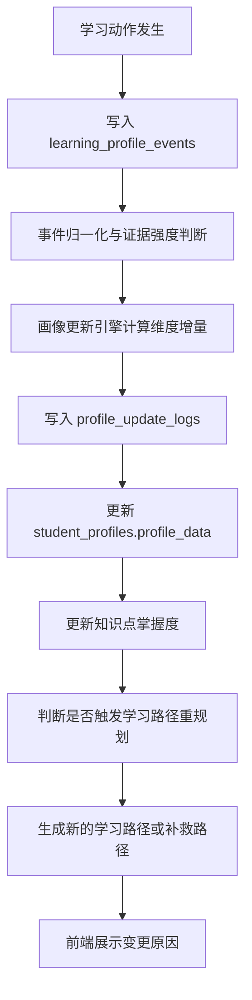
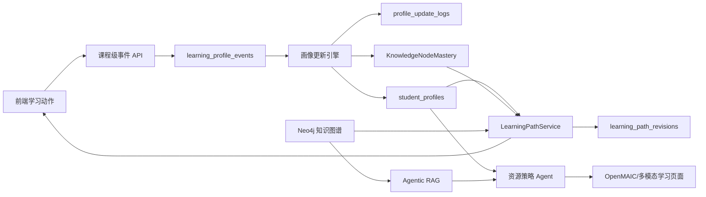

# 学生画像随学随新与动态学习路径需求说明

## 1. 背景

本项目当前已经具备课程选择、课程专属画像访谈、课程知识库、知识图谱、学习路径、学习页面、学习评估等核心链路。后续需要把学生画像从“访谈后得到的一次性静态画像”升级为“能够整体描述学生、并随着学习行为持续演化的课程级学习画像”。

赛题要求中的关键能力包括：

- 对话式学习画像自主构建；
- 不少于 6 个画像维度，且画像能描述学生学习特征；
- 学生在平台学习过程中，画像需要随学随新；
- 个性化学习路径、资源推送和学习任务需要根据画像、知识图谱、评估结果动态调整；
- 多智能体需要围绕分析、生成、校验、决策形成闭环。

因此，本需求文档定义一套课程级、可追踪、可解释、可动态更新的学生画像系统，并规定画像变化如何影响学习路径、资源生成、知识图谱掌握状态和后续学习任务。

## 当前落地状态

截至当前项目版本，以下能力已经进入代码主线：

- `student_profiles` 和 `profile_interviews` 已按 `user_id + course_id` 隔离。
- `learning_profile_events` 已用于记录评估、代码、课堂、智能辅导等学习动作。
- `DynamicProfileService` 已根据强/中/弱证据更新画像 JSON、画像更新日志和路径重规划记录。
- 综合评估会写入 `KnowledgeNodeMastery`，并把 `assessment_submitted` 事件回写画像。
- 智能辅导提问会在课程画像存在时记录 `tutor_question_asked` 事件。
- 学习路径服务会根据未通过节点插入薄弱点专项任务，`掌握基础` 仍视为未达标。
- 错题集从历史评估事件中归档错题，重做正确后提交 `wrong_question_redo` 综合评估并触发评分回写。

本需求文档后续章节仍保留完整目标模型，用于继续完善维度解释、前端可视化和更精细的路径策略。

## 2. 建设目标

### 2.1 产品目标

1. 用户选择具体课程后，系统为该用户在该课程下建立独立学生画像。
2. 学生画像不只记录学习目标和偏好，还要能整体描述该学生的知识基础、认知方式、学习习惯、时间约束、风险状态、能力成长和情绪/动机变化。
3. 学生在平台内发生任何重要学习动作，系统都要沉淀为画像证据，并按规则更新画像。
4. 画像更新后，学习路径、学习资源模态、每日任务时长、补救学习策略、知识图谱节点颜色和后续评估策略都要动态调整。
5. 每次画像更新都能说明“为什么更新、依据是什么、影响了哪些路径和资源策略”。

### 2.2 技术目标

1. 建立课程级画像数据模型：同一用户在 `C语言程序设计` 和 `Python程序设计` 中拥有完全独立的画像、证据、掌握度和学习路径。
2. 建立学习行为事件流：把课堂浏览、文档学习、思维导图交互、代码运行、测验、提问、反馈、任务完成等行为统一记录。
3. 建立画像更新引擎：根据事件类型、证据强度、时间衰减和置信度规则更新画像。
4. 建立动态规划规则引擎：根据画像变化和知识点掌握状态触发学习路径重排。
5. 保留 DeepSeek V4 Pro 与 Agentic RAG + 知识图谱约束：画像解释、资源策略和路径调整可调用大模型，但必须受 MySQL 原文证据、Milvus 召回和 Neo4j 关系约束。

## 3. 范围

### 3.1 本期范围

- 扩展学生画像维度。
- 定义画像证据和学习事件标准。
- 定义画像随学随新的更新规则。
- 定义学习路径动态调整规则。
- 定义后端数据模型、服务接口和前端展示要求。
- 定义多智能体在画像更新和路径调整中的职责。
- 定义验收标准。

### 3.2 非本期范围

- 不要求实现跨用户群体画像分析。
- 不要求构建教师端班级画像。
- 不要求引入实时流处理平台。首期可使用 MySQL 事件表 + 后端同步/异步服务实现。
- 不要求画像变化全部由大模型判断。稳定、可解释的规则应优先使用确定性逻辑，大模型负责总结、解释和复杂语义归因。

## 4. 核心原则

1. **课程隔离**：画像、事件、知识库、知识图谱、学习路径、评估记录必须以 `user_id + course_id` 为隔离边界。
2. **证据优先**：任何画像字段更新必须能追溯到访谈、学习行为、测验结果、代码运行结果或用户反馈。
3. **强弱证据分级**：代码运行、测验、综合评估是强证据；页面浏览、资源停留是弱证据；用户自述是中等证据。
4. **稳定事实不轻易覆盖**：专业、年级、长期目标等稳定信息不能被一次行为轻易改写。
5. **动态特征持续更新**：掌握度、薄弱点、学习节奏、资源偏好、注意力、风险状态等动态字段应随学习持续变化。
6. **可解释路径调整**：每次学习路径变更都必须展示触发原因，例如“代码题连续未通过，系统增加变量作用域补救任务”。
7. **低打扰**：画像更新默认自动完成，前端只在关键变化时提示用户，不频繁打断学习。

## 5. 学生画像模型扩展

学生画像应从当前基础字段扩展为“基础背景 + 学习目标 + 知识能力 + 学习行为 + 心理动机 + 资源偏好 + 评估偏好 + 风险趋势”的综合模型。

### 5.1 基础身份与课程上下文

| 字段 | 类型 | 说明 | 更新来源 |
| --- | --- | --- | --- |
| `student_id` | string | 学生画像标识 | 系统生成 |
| `user_id` | int | 用户标识 | 登录态 |
| `course_id` | int | 课程标识 | 当前课程 |
| `major` | string | 专业 | 访谈、用户修订 |
| `grade` | string | 年级 | 访谈、用户修订 |
| `course_name` | string | 课程名 | 课程表 |
| `course_goal` | string | 该课程下的学习目标 | 访谈、阶段反馈 |
| `profile_summary` | string | 对该学生在本课程中的整体描述 | 画像总结 Agent |

`profile_summary` 应能用自然语言整体描述学生，例如：

> 该学生是计算机专业大二学生，正在学习 Python 程序设计。其目标是补齐编程基础并能独立完成课程项目。当前具备基本语法理解能力，但在函数拆解、循环边界和调试策略上薄弱。学习时间集中在周末，每周约 1 小时，适合短任务、示例驱动和即时反馈的代码练习。

### 5.2 学习目标与动机

| 字段 | 类型 | 说明 |
| --- | --- | --- |
| `learning_goal` | string | 总体学习目标 |
| `short_term_goal` | string | 近期目标，例如通过本章测验 |
| `long_term_goal` | string | 长期目标，例如课程项目、竞赛、考试 |
| `motivation_profile` | object | 动机类型、目标驱动力、外部压力 |
| `motivation_level` | float | 动机强度，0-1 |
| `persistence_level` | float | 持续学习倾向，0-1 |

更新规则：

- 用户主动完成额外任务，提升 `persistence_level`。
- 多次进入学习页但不完成评估，降低 `persistence_level` 并提高风险状态。
- 用户反馈“太难、太慢、没兴趣”时，更新 `motivation_profile` 和风险提示。

### 5.3 知识基础与掌握度

| 字段 | 类型 | 说明 |
| --- | --- | --- |
| `knowledge_foundation` | string | 对课程基础的整体描述 |
| `prior_knowledge_map` | object | 入门前已有基础，按章节/知识点记录 |
| `mastery_distribution` | object | 当前知识点掌握分布 |
| `weak_points` | list[string] | 当前薄弱点 |
| `strong_points` | list[string] | 当前优势知识点 |
| `misconception_patterns` | list[string] | 常见误区模式 |
| `knowledge_graph_focus` | list[string] | 路径规划重点关注知识点 |

`mastery_distribution` 应与知识图谱节点状态联动：

- `not_started`：未学习，灰色；
- `severe_weak`：严重弱项，红色；
- `basic`：掌握基础，橙色；
- `good`：达标掌握良好，浅绿色；
- `proficient`：精通，绿色。

更新规则：

- 课堂完成但测验低分：该知识点进入 `weak_points`，节点状态变为 `severe_weak` 或 `basic`。
- 测验通过且代码题通过：该知识点从 `weak_points` 移除，进入 `good` 或 `proficient`。
- 同类错误连续出现，例如循环边界、变量类型、函数参数错误，写入 `misconception_patterns`。

### 5.4 认知与学习策略

| 字段 | 类型 | 说明 |
| --- | --- | --- |
| `learning_style` | string | 学习风格，例如案例驱动、图解优先 |
| `cognitive_style` | string | 认知方式，例如先整体后细节、先代码后概念 |
| `learning_strategy` | object | 有效策略，例如短讲解 + 代码练习 |
| `metacognition_level` | float | 自我监控能力 |
| `reflection_quality` | float | 反思反馈质量 |
| `debugging_strategy` | string | 编程调试习惯 |

更新规则：

- 学生频繁查看思维导图且测验提升，增强“结构化图解有效”的策略权重。
- 学生在代码题多次运行后能自行修复，提升 `debugging_strategy` 和 `metacognition_level`。
- 学生答题后反馈能准确描述错误原因，提升 `reflection_quality`。

### 5.5 时间、节奏与学习负荷

| 字段 | 类型 | 说明 |
| --- | --- | --- |
| `time_preference` | string | 用户自述时间偏好 |
| `available_days` | list[string] | 可学习日期，例如周六、周日 |
| `weekly_time_budget_minutes` | int | 每周学习预算 |
| `daily_time_budget_minutes` | object | 每天可学习分钟数 |
| `attention_pattern` | object | 停留时间、完成率、分心风险 |
| `cognitive_load_tolerance` | string | 可承受任务负荷 |

更新规则：

- 学生画像中写明“每天 1 小时”，学习路径必须按 7 天每日任务规划。
- 学生画像中写明“一周 1 小时，周末才有空”，学习路径只安排周末，周总时长不超过 60 分钟。
- 如果学生多次无法按时完成任务，系统降低单日任务量并拆分知识点。
- 如果学生连续超额完成任务，系统允许追加挑战任务，但不能影响当日最低任务展示。

### 5.6 资源模态偏好

| 字段 | 类型 | 说明 |
| --- | --- | --- |
| `resource_preference` | list[string] | 用户自述资源偏好 |
| `modality_effectiveness` | object | 各资源模态对该学生的效果 |
| `preferred_resource_order` | list[string] | 推荐资源展示顺序 |
| `interaction_preference` | string | 喜欢问答、代码实操、阅读、视频等 |

资源模态至少包含：

- `openmaic_classroom`：标准课堂；
- `document`：文档笔记；
- `mind_map`：树状思维导图；
- `code_lab`：在线编程练习；
- `exercise`：题库/测验；
- `reading`：拓展阅读；
- `video`：视频脚本或课堂片段。

更新规则：

- 某一资源模态使用后评估提升，增加该模态权重。
- 某一资源模态使用率低且效果差，降低推荐优先级。
- 对编程课，如果代码题表现弱，应提高 `code_lab` 和分步示例的推荐权重。

### 5.7 评估偏好与能力表现

| 字段 | 类型 | 说明 |
| --- | --- | --- |
| `assessment_preference` | string | 用户偏好的评估方式 |
| `quiz_performance` | object | 选择题、填空题、简答题表现 |
| `code_performance` | object | 编程题运行、通过、尝试次数 |
| `application_ability` | float | 综合应用能力 |
| `accuracy_trend` | list[float] | 正确率趋势 |
| `completion_trend` | list[float] | 完成率趋势 |

更新规则：

- 选择题高分但代码题失败，说明概念理解高于应用能力，路径应增加代码实操。
- 代码题通过但简答解释差，说明会操作但概念表达不足，路径应增加文档总结和解释型题目。
- 连续 2 次评估失败，触发补救路径。

### 5.8 情绪、风险与成长趋势

| 字段 | 类型 | 说明 |
| --- | --- | --- |
| `affective_state` | object | 信心、挫败、焦虑、兴趣 |
| `confidence_score` | float | 画像置信度或学习信心 |
| `learning_risk` | object | 掉队、拖延、高负荷、低动机风险 |
| `growth_trend` | object | 掌握度、完成率、提问质量等趋势 |
| `last_profile_update_reason` | string | 最近一次画像更新原因 |

更新规则：

- 测验通过、主动完成额外任务，提高信心和成长趋势。
- 多次失败或长时间停留同一知识点，提高挫败风险。
- 风险升高时，路径调度应降低难度、增加示例、缩短任务粒度。

## 6. 学习行为事件规范

系统内所有重要学习动作都应记录为课程级事件。事件不直接等同于画像，而是画像更新的证据来源。

### 6.1 事件基础字段

| 字段 | 类型 | 必填 | 说明 |
| --- | --- | --- | --- |
| `id` | int | 是 | 事件 ID |
| `user_id` | int | 是 | 用户 |
| `course_id` | int | 是 | 课程 |
| `student_profile_id` | int | 是 | 当前课程画像 |
| `knowledge_node_id` | string | 否 | 知识图谱节点 |
| `lesson_session_id` | int | 否 | 学习页会话 |
| `event_type` | string | 是 | 事件类型 |
| `event_payload` | json | 是 | 事件详情 |
| `evidence_strength` | string | 是 | weak/medium/strong |
| `created_at` | datetime | 是 | 发生时间 |

### 6.2 事件类型

| 事件类型 | 触发时机 | 证据强度 | 更新方向 |
| --- | --- | --- | --- |
| `profile_interview_answered` | 学生回答画像访谈 | medium | 初始画像字段 |
| `course_selected` | 用户选择课程 | weak | 课程上下文 |
| `material_uploaded` | 上传课程材料 | weak | 学习主动性 |
| `knowledge_graph_viewed` | 查看知识图谱 | weak | 学习路径关注点 |
| `graph_node_opened` | 点击知识节点 | weak | 关注知识点 |
| `learning_path_opened` | 查看学习路径 | weak | 学习计划使用 |
| `lesson_started` | 进入知识点学习页 | weak | 学习启动 |
| `openmaic_classroom_viewed` | 查看标准课堂 | medium | 资源偏好与完成率 |
| `document_viewed` | 查看文档笔记 | weak/medium | 资源偏好 |
| `mind_map_interacted` | 展开/点击思维导图 | medium | 结构化学习偏好 |
| `code_attempt_run` | 运行代码 | medium | 编程行为 |
| `code_attempt_passed` | 代码题通过 | strong | 编程能力、掌握度 |
| `quiz_submitted` | 提交课堂测验 | strong | 掌握度、误区 |
| `assessment_submitted` | 提交综合评估 | strong | 掌握度、路径调整 |
| `wrong_question_redo` | 错题集重做正确并提交 | strong | 掌握度修正、错题闭环 |
| `tutor_question_asked` | 向智能体提问 | medium | 薄弱点、元认知 |
| `feedback_submitted` | 提交学习反馈 | medium | 情绪、偏好 |
| `lesson_completed` | 完成本节课 | strong | 完成率、掌握度 |
| `path_replanned` | 系统重规划路径 | system | 路径变更记录 |

## 7. 画像随学随新规则

### 7.1 更新流程



### 7.2 证据权重

| 证据类型 | 权重建议 | 示例 |
| --- | --- | --- |
| 强证据 | 0.7-1.0 | 综合评估、代码题通过/失败、章节测验 |
| 中证据 | 0.4-0.7 | 学生反馈、智能体提问、课堂完成 |
| 弱证据 | 0.1-0.4 | 页面浏览、节点点击、资源停留 |
| 系统推断 | 0.2-0.5 | 根据连续行为推断风险或偏好 |

### 7.3 更新约束

1. 一次弱证据不能覆盖已有稳定字段。
2. 动态字段可以被多次弱证据累计影响。
3. 强证据可直接更新掌握度、薄弱点、代码能力和评估表现。
4. 如果事件与现有画像冲突，应写入待确认变化，不立即覆盖。例如用户自述偏好视频，但长期只完成代码练习且效果更好，系统应将代码练习权重提高，同时保留自述偏好。
5. 画像字段应维护 `confidence`，低置信度字段在前端显示为“待进一步观察”。

### 7.4 更新示例

#### 示例 1：代码题多次失败

输入事件：

- `code_attempt_run`，运行 4 次未通过；
- `quiz_submitted`，概念题正确率 80%；
- `assessment_submitted`，综合得分 58%。

画像更新：

- `code_performance.pass_rate` 降低；
- `weak_points` 增加当前知识点；
- `misconception_patterns` 增加具体错误模式；
- `resource_preference` 中 `code_lab` 权重提高；
- `learning_risk.high_load` 提高；
- 当前知识图谱节点状态更新为 `severe_weak` 或 `basic`。

路径调整：

- 暂停推进主线下一知识点；
- 插入补救任务：概念复盘、带提示代码练习、短测验；
- 补救通过后回到主线。

#### 示例 2：学生连续超额完成

输入事件：

- 当日任务完成；
- 继续完成后续 2 个知识点；
- 测验均通过。

画像更新：

- `persistence_level` 提升；
- `growth_trend.mastery_velocity` 提升；
- `cognitive_load_tolerance` 提升；
- 对应节点状态更新为 `good` 或 `proficient`。

路径调整：

- 保留每日最低任务；
- 展示“可继续挑战”的后续任务；
- 不强制增加每天最低任务，避免破坏用户画像中的时间约束。

## 8. 动态学习路径规则

学习路径必须由课程画像、知识图谱、知识点掌握度和时间约束共同生成，不能写死。

### 8.1 输入

- `StudentProfileRecord.profile_data`：课程级画像；
- Neo4j 知识图谱：章节、知识点、前置/后继关系；
- `KnowledgeNodeMastery`：当前用户在当前课程的节点掌握度；
- 学习事件趋势：完成率、失败率、资源使用效果；
- 当前学习节点和章节；
- 用户选择的当前课程。

### 8.2 输出

- 当前主线章节；
- 今日任务；
- 后续可选任务；
- 补救任务；
- 推荐资源模态；
- 每项任务预计时长；
- 路径调整原因；
- 下一次评估策略。

### 8.3 主线推进规则

1. 学习路径按知识图谱结构推进，章节节点只作为导航和分组，不作为学习任务。
2. 当前章节未完成前，主线优先保持在当前章节。
3. 当前知识点评估通过后，推进到同章后继知识点。
4. 当前章节所有知识点达到 `good` 或 `proficient` 后，进入下一章。
5. 若用户切换章节，系统可以生成该章节路径，但必须标识“章节切换路径”，不能污染主线进度。

### 8.4 补救路径规则

触发条件：

- 综合评估未通过；
- 代码题连续失败；
- 同一知识点测验连续 2 次低于阈值；
- 学生反馈“看不懂、太难、不会做”；
- 当前知识点状态为 `severe_weak`。

补救路径内容：

- 当前失败知识点；
- 该知识点的必要前置知识；
- 同章节关联弱点；
- 更低难度资源；
- 更短任务；
- 更多代码示例或图解说明。

退出补救条件：

- 补救测验通过；
- 代码题通过；
- 综合评估达到阈值；
- 节点状态至少达到 `good`。

### 8.5 时间规划规则

1. `weekly_time_budget_minutes` 是硬约束，默认不得超过。
2. `available_days` 决定任务安排日期。
3. `daily_time_budget_minutes` 决定每个学习日任务量。
4. 今日日期等于任务日期时，前端显示为“今日任务”。
5. 非今日任务按画像中的学习日期继续顺延。
6. 若学生超额学习，系统展示“继续学习”任务，但不把超额任务算作新的最低要求。

示例：

- 画像为“每天 1 小时”：每周 7 天，每天约 60 分钟。
- 画像为“一周 1 小时，周末才有空”：只安排周六/周日，总时长 60 分钟。
- 画像为“工作日晚上 30 分钟”：只安排周一至周五，每天 30 分钟。

### 8.6 资源推荐规则

资源推荐应由画像和评估共同决定：

- 图解有效：优先思维导图、结构图、可视化解释；
- 代码能力弱：优先代码实验、即时运行、带提示练习；
- 概念表达弱：增加文档笔记、简答题、复述任务；
- 动机低或负荷高：减少长文档，增加短课堂和即时反馈；
- 已精通知识点：减少基础资源，增加挑战题或项目任务。

## 9. 数据模型建议

### 9.1 `student_profiles`

保留现有表，扩展 `profile_data` JSON 结构，并增加可选元字段：

- `profile_version`：画像版本号；
- `last_event_id`：最近处理事件；
- `last_replanned_at`：最近路径重规划时间；
- `profile_summary`：整体画像描述；
- `dimension_confidence`：各维度置信度。

### 9.2 新增 `learning_profile_events`

用于记录所有学习动作。

核心字段：

- `id`
- `user_id`
- `course_id`
- `student_profile_id`
- `knowledge_node_id`
- `lesson_session_id`
- `event_type`
- `event_payload`
- `evidence_strength`
- `created_at`

### 9.3 新增 `profile_update_logs`

用于记录画像更新历史和可解释原因。

核心字段：

- `id`
- `user_id`
- `course_id`
- `student_profile_id`
- `source_event_id`
- `changed_dimensions`
- `before_snapshot`
- `after_snapshot`
- `update_reason`
- `confidence_delta`
- `created_at`

### 9.4 新增 `learning_path_revisions`

用于记录路径重规划历史。

核心字段：

- `id`
- `user_id`
- `course_id`
- `trigger_type`
- `trigger_event_id`
- `trigger_node_id`
- `previous_plan`
- `next_plan`
- `change_summary`
- `created_at`

## 10. 后端服务需求

### 10.1 画像事件服务

服务名建议：`LearningProfileEventService`

职责：

- 接收学习行为事件；
- 校验 `user_id + course_id` 权限；
- 写入 `learning_profile_events`；
- 调用画像更新引擎；
- 必要时触发路径重规划。

建议接口：

```http
POST /api/courses/{course_id}/profile-events
GET /api/courses/{course_id}/profile-events
```

### 10.2 画像更新引擎

服务名建议：`DynamicProfileService`

职责：

- 根据事件生成画像维度增量；
- 合并强弱证据；
- 更新 `student_profiles.profile_data`；
- 生成 `profile_summary`；
- 写入 `profile_update_logs`；
- 返回是否需要重规划路径。

### 10.3 路径重规划服务

复用当前 `LearningPathService`，新增触发上下文：

- `trigger_type`
- `trigger_event_id`
- `failed_node_id`
- `profile_delta`
- `force_remedial`

路径规划接口仍以当前课程为边界：

```http
POST /api/courses/{course_id}/learning-paths/plan
```

新增可选字段：

```json
{
  "trigger_type": "assessment_failed",
  "focus_node_id": "node-xxx",
  "reason": "代码题未通过，当前知识点需要补救"
}
```

### 10.4 知识图谱掌握度服务

继续使用 `KnowledgeNodeMastery`，但更新来源应包含：

- 测验成绩；
- 代码题运行结果；
- 课堂完成状态；
- 综合评估；
- 补救学习结果。

节点状态必须与前端颜色规则一致：

- `not_started`：灰色；
- `severe_weak`：红色；
- `basic`：橙色；
- `good`：浅绿色；
- `proficient`：绿色。

## 11. 多智能体职责

### 11.1 画像分析 Agent

输入：

- 学习事件；
- 当前画像；
- 课程知识点；
- 评估结果。

输出：

- 画像维度增量；
- 更新原因；
- 置信度；
- 是否需要重规划。

要求：

- 不允许只根据一次弱行为大幅更新画像；
- 对于自然语言反馈，可调用 DeepSeek V4 Pro 做语义抽取；
- 输出必须是结构化 JSON。

### 11.2 证据校验 Agent

职责：

- 检查画像更新是否有事件证据；
- 检查知识点掌握度是否有评估证据；
- 检查路径调整是否符合知识图谱前后置关系。

### 11.3 路径决策 Agent

职责：

- 判断进入主线推进、补救学习、降难度、加挑战或保持当前路径；
- 输出路径调整解释；
- 保证时间安排符合画像时间约束。

### 11.4 资源策略 Agent

职责：

- 根据画像和评估表现调整资源模态；
- 决定学习页面中 OpenMAIC 课堂、文档、思维导图、代码练习、测验、阅读的展示顺序；
- 资源生成仍必须使用 Agentic RAG + 知识图谱约束。

## 12. 前端需求

### 12.1 学生画像页

应展示：

- 课程专属画像整体描述；
- 画像维度雷达或卡片；
- 当前薄弱点；
- 当前优势点；
- 学习时间安排；
- 资源偏好与实际有效性；
- 最近画像更新原因；
- 画像置信度。

用户应能看到：

- “画像来自哪些证据”；
- “最近一次学习行为更新了哪些维度”；
- “画像变化对学习路径产生了什么影响”。

### 12.2 学习路径页

应展示：

- 今日任务；
- 后续可继续学习任务；
- 当前章节主线；
- 补救路径；
- 路径调整原因；
- 每个任务的推荐资源类型和预计时长。

当画像变化触发路径重规划时，应给出提示：

> 根据你在“循环结构”代码题中的表现，系统将今天的后续任务调整为 1 个补救练习和 1 个短测验，通过后回到主线。

### 12.3 知识图谱页

应展示：

- 课程知识结构；
- 知识点掌握颜色；
- 点击节点后显示掌握状态、证据、最近评估、推荐学习动作；
- 颜色更新与评估结果联动。

### 12.4 学习页面

学习页面应在以下动作后写入事件：

- 进入课堂；
- 完成 OpenMAIC 标准课堂；
- 查看文档；
- 交互思维导图；
- 运行代码；
- 完成代码题；
- 提交随堂测验；
- 完成综合评估；
- 提交反馈。

学习页面完成后，应展示：

- 本节课评分；
- 多维评估结果；
- 画像更新摘要；
- 知识图谱节点状态变化；
- 下一步学习路径变化。

### 12.5 智能辅导与错题集

智能辅导应作为全局悬浮窗出现在登录后的所有页面：

- 支持文字、图片和浏览器语音输入；
- 回答基于当前课程 Agentic RAG、MySQL 原文证据、Neo4j 图谱约束和大模型增强生成；
- 图片理解默认使用 Qwen3.7-Plus；
- 普通学生 UI 不展示原始 RAG 证据、结构化讲解卡和图谱关系调试块；
- 提问行为写入 `tutor_question_asked` 事件。

错题集应作为学习评估页的独立入口：

- 路由为 `/courses/:courseId/assessment/wrong-questions`；
- 错题按图谱章节和小节分组；
- 选择题展示原题、选项、学生答案和正确答案；
- 编程题展示任务、期望输出、历史输出和重做编辑器；
- 重做正确后提交 `wrong_question_redo` 评估，更新该知识点评分、画像、掌握度和学习路径。

## 13. 验收标准

### 13.1 画像维度验收

- 学生画像不少于 15 个有效维度。
- 画像能生成一段完整自然语言总结，用于整体描述该学生在当前课程中的学习状态。
- 同一用户在 C 语言和 Python 两门课中的画像完全独立。
- 画像字段包含置信度、证据和最近更新原因。

### 13.2 学习事件验收

- 课堂、文档、思维导图、代码练习、测验、反馈等动作均能写入事件。
- 事件包含 `user_id + course_id + knowledge_node_id`。
- 事件不会跨课程影响画像。

### 13.3 画像更新验收

- 提交低分测验后，画像薄弱点和知识点掌握状态会更新。
- 代码题多次失败后，画像会增加编程弱点或调试问题。
- 学生完成额外任务后，画像成长趋势或坚持度会更新。
- 每次更新都能查看更新原因。

### 13.4 学习路径动态调整验收

- 评估未通过后，路径进入补救任务。
- 补救通过后，路径回到主线。
- 时间安排符合画像中的可学习时间和总时长。
- 资源推荐顺序会随画像和评估结果变化。
- 知识图谱节点颜色会随掌握度变化。
- 错题重做正确后，相关知识点评分和掌握状态能被重新计算。

### 13.5 多课程隔离验收

- 用户在 Python 课程产生的学习事件不能更新 C 语言画像。
- 用户在 C 语言课程的知识图谱节点状态不能出现在 Python 课程。
- 切换当前课程后，侧边栏知识图谱、学习路径、学习评估都加载当前课程数据。

## 14. 实施优先级建议

### P0：必须完成

- 学习事件表；
- 画像扩展字段；
- 画像更新日志；
- 评估后更新画像和知识点掌握度；
- 学习路径根据画像和掌握度重新规划；
- 多课程隔离校验。

### P1：重要增强

- 资源模态有效性统计；
- 思维导图交互事件；
- 代码运行行为画像；
- 路径重规划历史；
- 前端展示画像更新原因。

### P2：长期优化

- 大模型辅助生成画像总结；
- Agent 辩论判断画像更新是否合理；
- 多轮学习趋势分析；
- 个性化提醒与学习风险预警。

## 15. 风险与约束

1. 学习行为数据可能较多，首期可以使用 MySQL 事件表，后期再考虑队列或流式处理。
2. 大模型不能直接决定所有画像更新，否则结果不可控；必须以规则和证据为主。
3. 画像更新过于频繁可能导致路径震荡，应设置重规划阈值和冷却时间。
4. 用户自述偏好和真实行为偏好可能冲突，应并存记录，并通过置信度解释。
5. 所有画像和事件必须遵守课程隔离，避免测试账号、内置课程、不同用户之间数据串扰。

## 16. 推荐总体架构



该架构的核心是：学习行为先变成事件，事件再变成画像证据，画像和掌握度共同驱动学习路径，而学习路径再反过来影响学生下一步学习动作，形成持续闭环。
