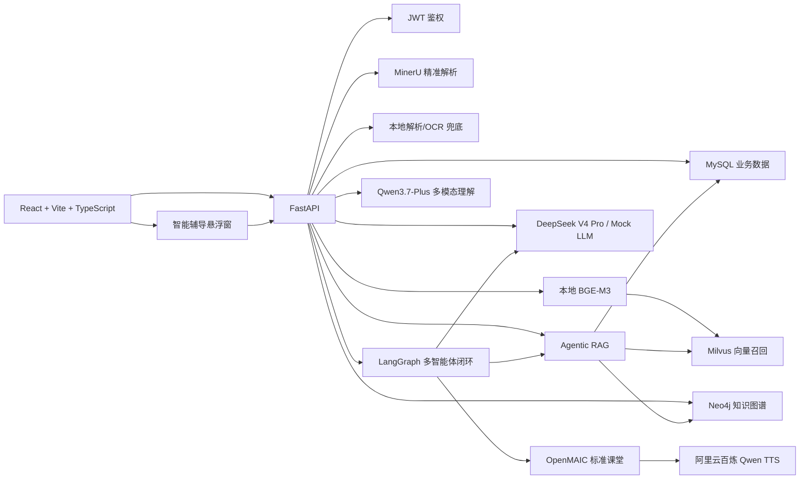

# 技术方案

## 1. 场景选择

系统面向多课程个性化学习平台，而不是单课程演示页。当前竞赛展示课程固定为 `C语言程序设计` 与 `Python程序设计`。用户登录后必须先选择课程，再进入该课程专属的画像、知识库、知识图谱、学习路径、标准课堂、学习评估、错题集和智能辅导闭环。

核心目标是把课程材料转化为可检索的本地知识库和可约束推理的课程知识图谱，再结合学生画像生成个性化学习路径和多模态教学资源。资源生成必须基于本地证据，避免只靠大模型自由发挥。

## 2. 总体架构



## 3. 技术选型

- 前端：React + Vite + TypeScript + React Router。页面采用课程优先的路由化产品流程。
- 后端：FastAPI + SQLAlchemy。核心业务接口通过 JWT 保护。
- 数据库：MySQL 保存用户、课程、画像、材料、chunk、学习路径、课堂状态、评估和掌握度。
- 文档解析：MinerU 精准解析优先；本地 pypdf、python-pptx、PyMuPDF、PaddleOCR 仅作为显式兜底。
- 向量检索：本地 BGE-M3 生成 embedding，Milvus 保存课程级向量集合。
- 知识图谱：DeepSeek V4 Pro 抽取知识点与关系，Neo4j 按 `user_id + course_id` 保存课程子图。
- 多智能体：LangGraph `StateGraph` 编排分析、检索、生成、校验、辩论、决策和课堂提交。
- 标准课堂：OpenMAIC 负责课堂生成和课堂前端展示，语音默认使用 OpenMAIC 侧配置的阿里云百炼 Qwen TTS。
- 智能辅导：全局悬浮窗 + `POST /api/tutor/chat`，文本回答走 Agentic RAG + 文本 LLM，图片问题走 Qwen3.7-Plus 多模态模型。
- 学习评估：综合课堂状态、题库、编程题、行为事件和错题重做结果，写回画像、掌握度和路径。
- LLM：DeepSeek V4 Pro 作为真实模型接口，Mock LLM 保留为演示兜底。

## 4. 课程级数据隔离

多课程隔离是当前架构的硬约束。所有核心数据必须带当前用户和课程上下文：

| 数据 | 隔离键 |
| --- | --- |
| 学生画像 | `user_id + course_id` |
| 画像访谈 | `user_id + course_id` |
| 课程材料 | `course_id`，课程归属 `user_id` |
| 知识切片 | `course_id + material_id` |
| Milvus collection | `course_id + embedding_provider + embedding_model_hash` |
| Neo4j 子图 | `user_id + course_id` |
| 学习路径 | `user_id + course_id` |
| 课堂缓存 | `user_id + course_id + node_id` |
| 学习评估 | `user_id + course_id + node_id` |
| 掌握度 | `user_id + course_id + node_id` |
| 智能辅导 | `user_id + course_id + node_id/page_context` |
| 错题集 | 当前课程 `assessment_submitted` 事件 + 图谱章节归档 |

内置课程也不是全局共享数据。用户点击确认使用内置课程后，后端创建该用户自己的课程记录、材料记录、chunk、图谱构建任务和 Neo4j 子图。

## 5. 学生画像

学生画像通过课程级对话访谈构建。首问固定，后续问题由 DeepSeek V4 Pro 根据当前课程、用户回答和画像缺口动态追问。画像维度完整后自动确认并持久化。

画像至少包含：

- 专业、年级、学习目标
- 知识基础、薄弱点、知识图谱关注点
- 学习风格、认知风格、资源偏好
- 时间偏好、约束条件、评估偏好
- 动机、信心、完成度

画像不是静态结果。学习过程中的课堂完成、练习得分、代码运行、重试、耗时、薄弱点和超前学习行为都应持续更新画像，并触发学习路径重规划。

## 6. 知识库构建

```text
PDF/PPT/PPTX 上传
 -> 保存文件与 CourseMaterial，返回 queued
 -> MaterialTaskQueue 后台运行
 -> MinerU 精准解析
 -> 本地解析/OCR 显式兜底
 -> 章节语义分块
 -> KnowledgeChunk 写入 MySQL
 -> BGE-M3 向量化
 -> Milvus course-scoped upsert
 -> 解析状态变为 parsed 或 index_failed/failed
```

上传接口不能同步等待几百页教材解析完成。当前后台队列是进程内 `ThreadPoolExecutor`，适合原型演示；生产环境应替换为 Redis/Celery/RQ 等持久化任务队列。

`index_failed` 表示 MySQL chunk 已保留但 Milvus 写入失败。用户修复 Milvus 后可从已有 MySQL chunk 重建向量索引，不需要重新上传材料。

## 7. 知识图谱

知识图谱从本地知识库 chunk 中抽取，不直接依赖 PDF 目录标题。抽取结果写入 Neo4j，并以当前用户和课程为隔离条件。

规范：

- 根节点是课程名，例如 `Python程序设计` 或 `C语言程序设计`。
- 图谱要尽量保留章节、节、小节和知识点的完整结构。
- 章节节点用于组织结构；有子知识点的节点不作为学习路径任务。
- 节点颜色只表达掌握状态：灰色未学习、红色严重弱项、橙色掌握基础、浅绿色达标良好、绿色精通。

## 8. Agentic RAG

资源生成阶段采用 Agentic RAG + 知识图谱约束：

```text
当前知识点
 -> 读取 Neo4j 当前节点、父章节、前置、后续、相关节点
 -> 构造多路检索查询
 -> Milvus 召回候选 chunk id
 -> MySQL 回表取得原文 chunk
 -> MySQL fallback 兜底
 -> 将原文证据、图谱约束、画像约束拼接给 LLM 和 OpenMAIC
```

Milvus 是召回层，MySQL `knowledge_chunks.content` 是最终证据源。任何生成给学生看的知识内容，都应能回溯到本地知识库 chunk 或明确标识为推理/教学组织内容。

## 9. 多智能体闭环

学习资源生成不是单次提示词，而是“分析-检索-生成-校验-辩论-决策”的闭环：

1. 分析规划 Agent：生成 `analysis_plan` 和资源蓝图。
2. 检索证据 Agent：执行 Agentic RAG，输出 `retrieval_trace`。
3. 文档 Agent：生成讲解文档。
4. 思维导图 Agent：生成树状思维导图结构。
5. 视频脚本 Agent：生成课堂讲解脚本和分镜。
6. 代码实操 Agent：生成浏览器可运行编程练习。
7. 练习题 Agent：生成选择、填空、简答、编程题等测评资源。
8. 拓展阅读 Agent：生成延伸阅读和复习任务。
9. 事实校验 Agent：检查证据支撑和图谱边界。
10. 教学适配 Agent：检查难度、表达方式和画像匹配度。
11. 辩论交叉验证 Agent：找出冲突、越界内容和幻觉风险。
12. 决策 Agent：输出 `accepted`、`retrieve_more`、`revise` 或兜底路径。
13. OpenMAIC 课堂 Agent：提交通过闭环的大纲到 OpenMAIC。

后端资源响应应展示 `analysis_plan`、`graph_constraints`、`retrieval_trace`、`verification_report`、`pedagogy_report`、`debate_report`、`decision_report`、`agent_events` 和 `openmaic_classroom`。

## 10. OpenMAIC 标准课堂

后端基于 Agentic RAG 和知识图谱约束调用 DeepSeek V4 Pro 生成课堂大纲 requirement，再提交给 OpenMAIC `/api/generate-classroom`。

OpenMAIC 课堂要求：

- 学习页主体嵌入 OpenMAIC 前端课堂。
- 后端通过 `GET /api/resources/openmaic-jobs/{job_id}` 代理轮询课堂任务，前端不直接跨域轮询 OpenMAIC。
- 课堂语音默认使用 OpenMAIC 自身配置的阿里云百炼 Qwen TTS。
- VoxCPM2 保留为 FastAPI `/tts/upload` 的可选实验兜底，不作为默认 TTS。
- 根据知识点类型选择一个重点交互策略：抽象结构用 3D 可视化，编程实操用 code widget，巩固挑战用 game，过程探索用 simulation。
- 课堂状态写入 `CourseLessonSession.lesson_state`，同一知识点重新进入时优先读取缓存；显式重新生成才清理旧课堂缓存并重新提交 OpenMAIC。

## 11. 智能辅导

智能辅导是登录后全局可用的课程级辅助能力。前端在应用壳层右下角提供入口，支持文字、图片和浏览器语音输入。

后端 `TutorService` 工作流：

1. 根据 `course_id` 校验课程归属。
2. 汇总问题、图片附件、页面上下文、对话历史和当前 `node_id`。
3. 调用 Agentic RAG 构造本地课程证据：Milvus 召回、MySQL 回表、Neo4j 图谱约束。
4. 过滤与问题不相关的 chunk，避免把无关章节内容带入回答。
5. 带图片时调用 `TUTOR_VISION_MODEL=qwen3.7-plus` 的 OpenAI-compatible 多模态接口；纯文本时使用主 LLM。
6. 返回自然语言回答、agent 事件、检索轨迹和决策报告。
7. 画像存在时记录 `tutor_question_asked` 事件，作为后续画像随学随新的证据。

面向学生的 UI 默认隐藏原始 RAG 证据、结构化卡片和图谱关系调试信息，只展示增强回答和可操作建议。

## 12. 学习路径、评估与错题集

学习路径由课程画像、知识图谱和掌握度共同生成：

- 路径规划必须尊重画像中的可用时间。
- 主线路径按知识图谱顺序推进，同一章未完成前不跳到下一章。
- 有三级知识点时，学习任务规划三级知识点；没有子节点时才规划二级节点。
- 评估未达标时插入薄弱点专项任务，例如 `1.1.1 -> 1.1.1 薄弱点专项 -> 1.1.2`。
- 专项任务点击后仍回到原知识图谱节点，使用原节点的 RAG 证据和图谱约束生成补救资源。
- `掌握基础` 视为未达标；只有 `达标良好` 和 `精通` 才算通过。

评估数据应更新：

- 知识点掌握度
- Neo4j/前端图谱颜色状态
- 学生画像薄弱点和学习行为维度
- 后续学习路径

题库由题库 Agent 基于当前知识点、本地证据和图谱约束生成。选择题需要保存题干、选项、学生选择和 `correct_answer_index`；编程题只给要求、起始代码和期望输出，不给完整答案。C 语言课程应生成 C 语言代码练习，Python 课程应生成 Python 代码练习。

错题集从课程级学习事件中提取未答对的选择题和未通过的编程题，路由为 `/courses/:courseId/assessment/wrong-questions`。错题按图谱章节和小节归档，学生重做正确后提交 `wrong_question_redo` 类型的综合评估 payload，触发重新评分、画像更新、掌握度更新和路径重规划。

## 13. 安全与降级

- 所有核心学习接口必须带 `Authorization: Bearer <token>`。
- Provider Key、MinerU Token、Neo4j 密码、Qwen TTS Key 只写本地 `.env`。
- 智能辅导图片理解密钥使用 `TUTOR_VISION_API_KEY`，可复用 `QWEN_API_KEY` 或 `DASHSCOPE_API_KEY` 环境变量。
- MinerU 启用但缺少 Token 时应快速失败，不静默回落到慢 OCR。
- Mock LLM 必须保留，保证演示环境无外部 API 时仍可跑通主流程。
- 运行产物如 `data/uploads/`、`data/models/`、OpenMAIC 生成课堂、日志和缓存不提交 Git。
